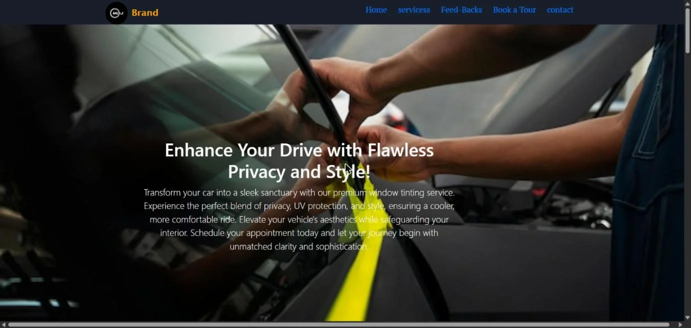
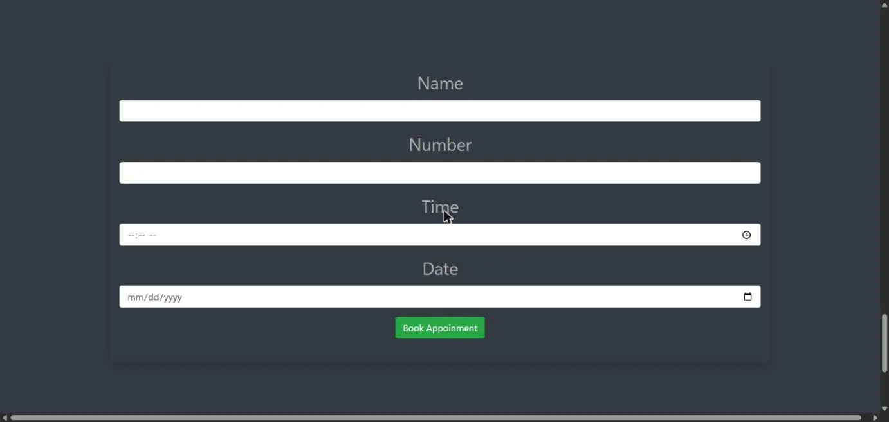
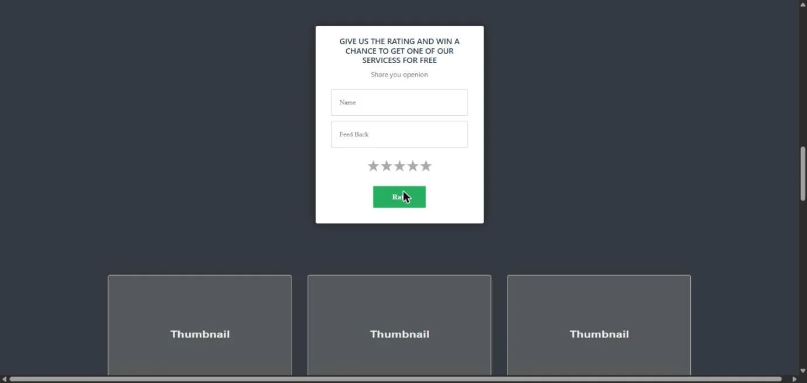

# 🚿 MD Jacob Car Wash

A responsive one page website for a car wash and detailing business: services, ratings, booking an appointment and contact details. Front end design only (no backend yet).

**Live demo:** [carwash-wjmz.vercel.app](https://carwash-wjmz.vercel.app)



## Screenshots

| Book an appointment | Rate us and win a free service |
|---|---|
|  |  |

## Sections

- **Home:** hero banner with the business tagline
- **Services:** photo carousel of car washing, window tinting and wheel polishing
- **Feedback:** 5 star rating form with a chance to win a free service
- **Appointment:** name, phone number, time and date
- **Contact:** contact form and business details

## Tech stack

| Part | Used |
|---|---|
| Markup and style | HTML5, CSS3 |
| Layout | Bootstrap 4 (navbar, grid, carousel) |
| Icons and fonts | Font Awesome, Google Fonts |
| Hosting | Vercel |

## Run it locally

No build step. Open `index.html` in a browser, or serve the folder:

```bash
npx serve .
```

## Project structure

```
carwash/
├── index.html   # all sections of the page
├── style.css    # custom styles
├── index.js     # reserved for future scripts
├── assets/      # service photos and logo
└── docs/        # screenshots used in this README
```

## Next steps

- Connect the appointment and feedback forms to a backend
- Replace the stock photos with the business's own photos

## Author

**Rohullah Hussaini** · [GitHub @Rohullah1122](https://github.com/Rohullah1122) · [Portfolio](https://rohullah-hussaini.vercel.app)
